<picture>
  <source media="(prefers-color-scheme: dark)" srcset=".github/assets/hero-dark.svg">
  
</picture>

<p align="center">
  <a href="https://github.com/SahilIjaz/studymate/actions/workflows/backend-ci.yml"></a>
  <a href="https://github.com/SahilIjaz/studymate/actions/workflows/frontend-ci.yml"></a>
  <a href="LICENSE"></a>
  
  
  
  
  
</p>

<p align="center">
  <a href="#quick-start">Quick start</a> ·
  <a href="#how-it-works">How it works</a> ·
  <a href="#api-at-a-glance">API</a> ·
  <a href="study-mate-backend/README.md">Backend docs</a> ·
  <a href="studyMate-frontend/README.md">Frontend docs</a>
</p>

---

StudyMate is a retrieval-augmented generation (RAG) application for studying from your own documents. Upload PDFs, ask questions in plain language, and get answers that are streamed token by token and cite the exact page they came from. It is built as a FastAPI service and a Next.js client, runs on a single small container, and uses Gemini's free tier by default, so the whole thing costs nothing to run.

## Highlights

| | |
|---|---|
| **Hybrid retrieval** | Dense vectors (FAISS, cosine) catch paraphrases; BM25 catches exact terms, course codes and names. The two rankings are merged with reciprocal rank fusion. |
| **Honest answers** | A relative score cutoff drops weak matches. An off-topic question returns no sources and a clear "not in your documents" instead of a confident guess. |
| **Page-level citations** | The model is given numbered passages and cites them as `[1]`, `[2]`. The UI renders each one as a chip that opens the exact passage, filename and page range. |
| **Streaming** | Answers arrive over Server-Sent Events: sources first, then text deltas, then token usage. A stage indicator shows searching, reading and writing. |
| **Conversations with memory** | Follow-ups like "explain that more simply" are rewritten into standalone search queries by a small model before retrieval. |
| **Workspace isolation** | Every request carries an opaque workspace id. Documents, indexes and conversations never cross workspaces. |
| **Persistence** | SQLite for metadata and chunks, a FAISS index file per workspace, uploads on disk. A restart or redeploy loses nothing. |
| **Operational hygiene** | Pinned dependencies, structured JSON logs with request ids, typed error codes, per-workspace rate limits, upload sniffing and size caps, health and readiness probes. |

## How it works

<picture>
  <source media="(prefers-color-scheme: dark)" srcset=".github/assets/pipeline-dark.svg">
  
</picture>

1. **Ingest.** An upload is sniffed, size-capped and de-duplicated by hash, then returns `202 processing` immediately. In the background each page is extracted, cleaned, split into overlapping sentence chunks and embedded, so every chunk knows its pages. The UI polls until the document is `ready`.
2. **Retrieve.** The question (or its rewritten standalone form) is searched two ways at once, dense and sparse. Reciprocal rank fusion merges the lists, the weak tail is cut, and the top passages are numbered.
3. **Generate.** The numbered passages go to the model as data inside `<source>` tags, with recent conversation turns. The model answers only from them and cites inline.
4. **Stream.** The client receives the cited sources before the first token, then text deltas, then usage. Citations are resolved into clickable chips as the answer is written.

## Screenshots

<p align="center">
  
  
</p>

## Quick start

**With Docker** (both halves, one command):

```bash
GEMINI_API_KEY=your-key docker compose up --build
# Web: http://localhost:3000   API docs: http://localhost:8000/docs
```

**Without Docker:**

```bash
# API
cd study-mate-backend
python3.12 -m venv .venv && source .venv/bin/activate
pip install -r requirements-dev.txt
cp .env.example .env              # add GEMINI_API_KEY (free: https://aistudio.google.com/apikey)
python run.py                     # http://localhost:8000

# Web, in a second terminal
cd studyMate-frontend
npm install
cp .env.example .env.local        # NEXT_PUBLIC_API_URL=http://localhost:8000
npm run dev                       # http://localhost:3000
```

No key at hand? Set `LLM_MOCK=true` and `EMBEDDING_PROVIDER=hashed` in the backend `.env` and the whole app runs with canned answers. Claude is supported as an alternative provider via `ANTHROPIC_API_KEY`.

## Repository layout

```
studymate/
├── study-mate-backend/      FastAPI service
│   ├── app/                 api · core (chunking, retrieval, prompts) · services · storage
│   ├── tests/               44 tests: chunking, files, retrieval, HTTP API end to end
│   ├── deploy/k8s/          Kustomize manifests (deployment, service, ingress, PVC, secret template)
│   ├── Dockerfile · render.yaml · requirements.txt
│   └── README.md            architecture, configuration, API reference, design notes
├── studyMate-frontend/      Next.js 16 client
│   ├── app/                 App Router pages: landing, /app workspace
│   ├── components/          landing · workspace · ui
│   ├── lib/                 typed API client, SSE parser, citation rewriting, Zustand store
│   ├── tests/               Vitest + Testing Library
│   └── README.md            client architecture and design tokens
├── .github/workflows/       per-folder CI, path-filtered
├── docker-compose.yml       runs both halves together
└── Makefile                 make api · web · test · lint · up
```

## API at a glance

All routes except `/health*` take an `X-Workspace-Id: <uuid>` header. The full reference, including error codes, lives in the [backend README](study-mate-backend/README.md#api).

| Method | Path | Purpose |
|---|---|---|
| `POST` | `/documents` | Upload a PDF, returns `202` and indexes in the background |
| `GET` | `/documents/{id}` | Poll status: `processing` → `ready` or `failed` |
| `GET` | `/documents/{id}/suggestions` | Study questions generated from the opening pages |
| `POST` | `/chat/stream` | Ask a question, answer streamed as SSE |
| `POST` | `/chat/ask` | Same pipeline, single JSON response |
| `GET` | `/conversations/{id}` | Messages with citations and token usage |

```
event: meta      data: {"conversation_id":"conv_…","user_message_id":"msg_…"}
event: status    data: {"stage":"retrieving"}
event: sources   data: {"sources":[{"n":1,"filename":"biology.pdf","page_start":3,"page_end":3,"score":1.0,"text":"…"}]}
event: delta     data: {"text":"During **metaphase** the chromosomes align"}
event: delta     data: {"text":" along the equatorial plate [1]."}
event: done      data: {"message_id":"msg_…","usage":{"input_tokens":1840,"output_tokens":96}}
```

## Quality

```bash
make test      # backend: pytest with a fake LLM and hashed embeddings · frontend: vitest
make lint      # ruff check + format · eslint + tsc
```

- Backend tests run the real HTTP API against a fake model: upload, background indexing, event order, persisted citations, follow-ups with history, workspace isolation, rate limiting and the API-key gate. Test PDFs are generated in-process, so no fixtures are checked in.
- Frontend tests cover the SSE frame parser, citation rewriting and the answer Markdown renderer.
- CI runs on every push and pull request, separately per folder. Dependabot keeps pip, npm and the workflow actions current.

## Deployment

- **Docker.** Each half has a multi-stage `Dockerfile`; the compose file wires them together with a persistent data volume.
- **Render.** [`render.yaml`](study-mate-backend/render.yaml) is a blueprint for the API with a persistent disk for the database, uploads and indexes.
- **Kubernetes.** [`deploy/k8s`](study-mate-backend/deploy/k8s) holds Kustomize manifests with a PVC, probes and a secret template that is never committed filled in.

## Roadmap

- OCR fallback for scanned PDFs, which are currently rejected with a clear message.
- Cross-encoder reranking of the fused candidates.
- Real authentication (OIDC) so workspaces map to accounts.
- Upload progress over the same SSE channel.

## Author

**Sahil Ijaz** · [GitHub](https://github.com/SahilIjaz) · [LinkedIn](https://www.linkedin.com/in/sahil-ijaz-a75b15281) · hssahil2913@gmail.com

Licensed under the [MIT License](LICENSE).
