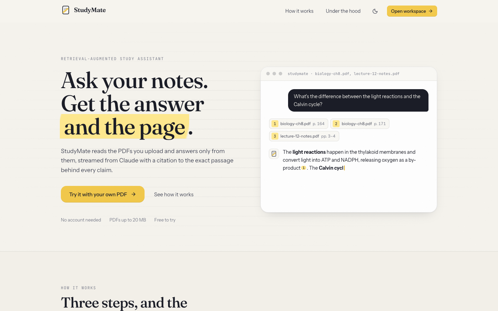
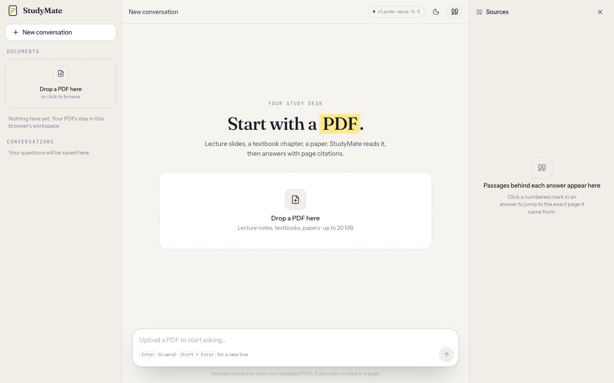

# StudyMate

Ask questions about your own PDFs and get answers with page-level citations, streamed from Gemini or Claude.



This is the web client. It talks to the [StudyMate API](../study-mate-backend/) (FastAPI, FAISS + BM25 hybrid retrieval, Gemini or Claude).

## What's in the box

- **Landing page** with a scripted replay of a real exchange, how-it-works, and the retrieval pipeline drawn as an animated diagram.
- **Workspace** with three panes: documents and conversations, the chat, and a sources panel.
  - Drag-and-drop PDF upload with byte-level progress, then background indexing status polled until ready.
  - Answers stream in over Server-Sent Events. Sources arrive first, then text, with a stage indicator (searching, reading, writing) and a stop button.
  - Inline citation marks `[1]` are rendered as highlighter chips. Click one to open the exact passage, filename and page range beside the answer.
  - Scope a question to specific documents from the sidebar.
  - Suggested questions generated from each document once it's indexed.
  - Conversations persist on the server and reopen on return.
  - Light and dark themes, keyboard shortcuts (`/` focuses the composer, `Enter` sends, `Esc` closes drawers), reduced-motion support, and a responsive layout down to phone width.



## Stack

Next.js 16 (App Router), React 19, TypeScript, Tailwind CSS v4, Motion for animation, react-markdown for answers, Zustand for state, Vitest + Testing Library for tests.

## Running locally

```bash
npm install
cp .env.example .env.local        # NEXT_PUBLIC_API_URL=http://localhost:8000
npm run dev                       # http://localhost:3000
```

Start the API first (see its README). The workspace shows an "offline" badge until it can reach `/health`.

```bash
npm run typecheck
npm run lint
npm test
npm run build
```

With Docker:

```bash
docker build --build-arg NEXT_PUBLIC_API_URL=https://api.example.com -t studymate-web .
docker run -p 3000:3000 studymate-web
```

## How the client talks to the API

Every request carries an `X-Workspace-Id` header: a UUID minted on first visit and kept in `localStorage`. It scopes documents and conversations on the server. There is no account system in this demo; the id is the workspace.

Questions are sent with `fetch` as a POST and the response body is read as an SSE stream ([lib/sse.ts](lib/sse.ts)). Text deltas are batched per animation frame before touching React state so Markdown re-renders stay cheap during long answers. Citation markers are rewritten into `#cite-n` links before rendering and intercepted by the Markdown renderer ([lib/citations.ts](lib/citations.ts)), which keeps code spans untouched.

```
lib/
├── api.ts          typed client, SSE event handlers, ApiError
├── sse.ts          frame parser (unit-tested)
├── citations.ts    [n] → chip links (unit-tested)
└── store.ts        Zustand store: documents, uploads, conversations, streaming
components/
├── landing/        Landing, LiveDemo, Architecture
├── workspace/      Workspace, Sidebar, Chat, Composer, MessageBubble, SourcesPanel, …
└── ui/             Button, Logo, ThemeToggle, Toasts
```

## Design

Tokens live at the top of [app/globals.css](app/globals.css). The palette is paper and ink with one highlighter accent, used only where a student would reach for a marker: citations, the active control, the answer being written. Fraunces for display type, Instrument Sans for the interface, JetBrains Mono for page numbers and metadata. Both themes are defined at the token level and switched with a `data-theme` attribute set before first paint.

## Author

Sahil Ijaz
